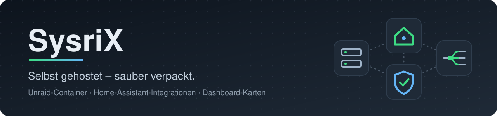

<p align="center">
  
</p>

<p align="center">
  <a href="#unraid-pakete"></a>
  <a href="#home-assistant"></a>
  
</p>

<p align="center">
  Eigene Bausteine fürs selbst gehostete Zuhause – jedes Projekt in einem eigenen Repository<br>
  mit Quellcode, Anleitung und automatischen Updates. Hier ist das Inhaltsverzeichnis.
</p>

<br>

<a id="unraid-pakete"></a>


<table>
  <tr>
    <td width="33%" valign="top">
      <a href="https://github.com/SysriX/haproxy_unraid"></a>
      <b><a href="https://github.com/SysriX/haproxy_unraid">haproxy-unraid</a></b><br>
      <sub>Reverse-Proxy</sub>
      <br clear="left"><br>
      Eingang für außen und innen: verteilt nach Name, beendet TLS oder reicht durch, wehrt Scanner ab. Änderungen werden geprüft und springen bei Fehlern zurück.
      <br><br>
      <a href="https://github.com/SysriX/haproxy_unraid/actions/workflows/image.yml"></a>
    </td>
    <td width="33%" valign="top">
      <a href="https://github.com/SysriX/haproxy-ui_unraid"></a>
      <b><a href="https://github.com/SysriX/haproxy-ui_unraid">haproxy-ui</a></b><br>
      <sub>Weboberfläche</sub>
      <br clear="left"><br>
      HAProxy im Browser pflegen: Dienste und Dateien bearbeiten, mit einem Klick prüfen und übernehmen, Live-Statistik, Meldung an Home Assistant per MQTT.
      <br><br>
      <a href="https://github.com/SysriX/haproxy-ui_unraid/actions/workflows/image.yml"></a>
    </td>
    <td width="33%" valign="top">
      <a href="https://github.com/SysriX/certwarden_unraid"></a>
      <b><a href="https://github.com/SysriX/certwarden_unraid">certwarden-unraid</a></b><br>
      <sub>Zertifikate</sub>
      <br clear="left"><br>
      Let's-Encrypt mit Weboberfläche, automatisch erneuert. DNS-01 für STRATO und Hetzner, Ablage auf eine Unraid-Freigabe für andere Container.
      <br><br>
      <a href="https://github.com/SysriX/certwarden_unraid/actions/workflows/image.yml"></a>
    </td>
  </tr>
  <tr>
    <td width="33%" valign="top">
      <a href="https://github.com/SysriX/mira_unraid"></a>
      <b><a href="https://github.com/SysriX/mira_unraid">MIRA</a></b><br>
      <sub>Admin-Zentrale</sub>
      <br clear="left"><br>
      Mail · Identity · Routing · Access: AD/Samba, Authentik, HAProxy, nginx, grommunio und Exchange aus einer Oberfläche – neuer Mitarbeiter in einem Rutsch.
      <br><br>
      <a href="https://github.com/SysriX/mira_unraid/actions/workflows/image.yml"></a>
    </td>
    <td width="33%"></td>
    <td width="33%"></td>
  </tr>
</table>

<details>
<summary><b>Installieren in Unraid</b></summary>
<br>

Bis die Pakete offiziell in Community Applications stehen, die Vorlagen einmal in der Unraid-Konsole holen:

```bash
Z=/boot/config/plugins/community.applications/private/sysrix; mkdir -p $Z; for p in haproxy_unraid:haproxy-unraid haproxy-ui_unraid:haproxy-ui certwarden_unraid:certwarden-unraid mira_unraid:mira; do curl -fsSL https://raw.githubusercontent.com/SysriX/${p%%:*}/main/templates/${p##*:}.xml -o $Z/${p##*:}.xml && echo "${p##*:} ok"; done
```

Danach unter **Apps › Private** installieren. Voraussetzungen und Einstellungen stehen in der Anleitung des jeweiligen Pakets.
</details>

<br>

<a id="home-assistant"></a>


<h3>Integrations</h3>

<table>
  <tr>
    <td width="33%" valign="top">
      <b><a href="https://github.com/SysriX/alarm_system_ha_integration">Alarm System</a></b><br>
      <sub>alarm_system_ha_integration · v1.2.0</sub>
      <br><br>
      Alarm system for Home Assistant: away/home/vacation modes, PIN per person, entry/exit delays, notifications, automation
      <br><br>
      <a href="https://my.home-assistant.io/redirect/hacs_repository/?owner=SysriX&amp;repository=alarm_system_ha_integration&amp;category=integration"></a>
    </td>
    <td width="33%" valign="top">
      <b><a href="https://github.com/SysriX/presence_simulation_ha_integration">Presence Simulation</a></b><br>
      <sub>presence_simulation_ha_integration · v1.2.0</sub>
      <br><br>
      House-wide presence simulation: realistic daily light plan (evening, bed, night, morning) with profiles and conditions
      <br><br>
      <a href="https://my.home-assistant.io/redirect/hacs_repository/?owner=SysriX&amp;repository=presence_simulation_ha_integration&amp;category=integration"></a>
    </td>
    <td width="33%" valign="top">
      <b><a href="https://github.com/SysriX/heat_control_ha_integration">Heat Control</a></b><br>
      <sub>heat_control_ha_integration · v1.0.0</sub>
      <br><br>
      Heating and cooling circuits per room: day periods, away/vacation, window lock, outdoor limits, heat pump support
      <br><br>
      <a href="https://my.home-assistant.io/redirect/hacs_repository/?owner=SysriX&amp;repository=heat_control_ha_integration&amp;category=integration"></a>
    </td>
  </tr>
  <tr>
    <td width="33%" valign="top">
      <b><a href="https://github.com/SysriX/light_lux_ha_integration">Light Lux Control</a></b><br>
      <sub>light_lux_ha_integration · v1.3.0</sub>
      <br><br>
      Brightness-based light control: profiles per room switch lights on when dark and off when bright, within time windows
      <br><br>
      <a href="https://my.home-assistant.io/redirect/hacs_repository/?owner=SysriX&amp;repository=light_lux_ha_integration&amp;category=integration"></a>
    </td>
    <td width="33%" valign="top">
      <b><a href="https://github.com/SysriX/light_schedule_ha_integration">Light Schedule</a></b><br>
      <sub>light_schedule_ha_integration · v1.4.0</sub>
      <br><br>
      Time-based light control with profiles per room: weekdays, date ranges, multiple slots, presence/alarm/lux conditions
      <br><br>
      <a href="https://my.home-assistant.io/redirect/hacs_repository/?owner=SysriX&amp;repository=light_schedule_ha_integration&amp;category=integration"></a>
    </td>
    <td width="33%" valign="top">
      <b><a href="https://github.com/SysriX/vent_control_ha_integration">Ventilation Control</a></b><br>
      <sub>vent_control_ha_integration · v1.2.0</sub>
      <br><br>
      Fan control per room by motion, humidity, air quality and interval, with run-on, quiet hours and window lock
      <br><br>
      <a href="https://my.home-assistant.io/redirect/hacs_repository/?owner=SysriX&amp;repository=vent_control_ha_integration&amp;category=integration"></a>
    </td>
  </tr>
  <tr>
    <td width="33%" valign="top">
      <b><a href="https://github.com/SysriX/access_monitor_ha_integration">Access Monitor</a></b><br>
      <sub>access_monitor_ha_integration · v1.0.0</sub>
      <br><br>
      Syslog receiver for HAProxy and OPNsense: shows allowed/rejected connections with reasons, counters and backend health
      <br><br>
      <a href="https://my.home-assistant.io/redirect/hacs_repository/?owner=SysriX&amp;repository=access_monitor_ha_integration&amp;category=integration"></a>
    </td>
    <td width="33%" valign="top">
      <b><a href="https://github.com/SysriX/battery_manager_ha_integration">Battery Manager</a></b><br>
      <sub>battery_manager_ha_integration · v2.4.0</sub>
      <br><br>
      Track every battery device in Home Assistant: classes, notification rules, replacement detection, forecasts, MariaDB
      <br><br>
      <a href="https://my.home-assistant.io/redirect/hacs_repository/?owner=SysriX&amp;repository=battery_manager_ha_integration&amp;category=integration"></a>
    </td>
    <td width="33%" valign="top">
      <b><a href="https://github.com/SysriX/home_twin_ha_integration">Home Twin</a></b><br>
      <sub>home_twin_ha_integration · v0.6.0</sub>
      <br><br>
      Digital twin backend for Home Assistant: floor plan storage with revisions in MariaDB plus BLE indoor tracking per room
      <br><br>
      <a href="https://my.home-assistant.io/redirect/hacs_repository/?owner=SysriX&amp;repository=home_twin_ha_integration&amp;category=integration"></a>
    </td>
  </tr>
  <tr>
    <td width="33%" valign="top">
      <b><a href="https://github.com/SysriX/waste_duty_ha_integration">Waste Duty</a></b><br>
      <sub>waste_duty_ha_integration · v1.0.0</sub>
      <br><br>
      Decide who in a shared house puts out which bin on which collection day, based on Waste Collection Schedule
      <br><br>
      <a href="https://my.home-assistant.io/redirect/hacs_repository/?owner=SysriX&amp;repository=waste_duty_ha_integration&amp;category=integration"></a>
    </td>
    <td width="33%" valign="top">
      <b><a href="https://github.com/SysriX/ring_intercom_talk_ha_integration">Ring Intercom Talk</a></b><br>
      <sub>ring_intercom_talk_ha_integration · v0.1.0</sub>
      <br><br>
      Two-way talk with a Ring Intercom (incl. audio-only model) from a Home Assistant dashboard via WebRTC
      <br><br>
      <a href="https://my.home-assistant.io/redirect/hacs_repository/?owner=SysriX&amp;repository=ring_intercom_talk_ha_integration&amp;category=integration"></a>
    </td>
    <td width="33%" valign="top">
      <b><a href="https://github.com/SysriX/washer_control_ha_integration">Washer Control</a></b><br>
      <sub>washer_control_ha_integration · v1.1.1</sub>
      <br><br>
      Control hOn washing machines in Home Assistant: start programs, cycle detection, laundry-done, history, maintenance
      <br><br>
      <a href="https://my.home-assistant.io/redirect/hacs_repository/?owner=SysriX&amp;repository=washer_control_ha_integration&amp;category=integration"></a>
    </td>
  </tr>
  <tr>
    <td width="33%" valign="top">
      <b><a href="https://github.com/SysriX/alarm_clock_ha_integration">Alarm Clock &amp; Bed</a></b><br>
      <sub>alarm_clock_ha_integration · v1.4.0</sub>
      <br><br>
      Bedside alarm clock for Home Assistant tablets with snooze, rising volume, watchdog, bed weight and heated blanket control
      <br><br>
      <a href="https://my.home-assistant.io/redirect/hacs_repository/?owner=SysriX&amp;repository=alarm_clock_ha_integration&amp;category=integration"></a>
    </td>
    <td width="33%"></td>
    <td width="33%"></td>
  </tr>
</table>

<h3>Dashboard cards</h3>

<table>
  <tr>
    <td width="33%" valign="top">
      <b><a href="https://github.com/SysriX/room_panel_ha_card">Room Panel</a></b><br>
      <sub>room_panel_ha_card · v2.106.0-beta.1</sub>
      <br><br>
      Full-screen wall-tablet dashboard card: block-grid glass frames with light, heating, weather, audio, alarm-clock modules
      <br><br>
      <a href="https://my.home-assistant.io/redirect/hacs_repository/?owner=SysriX&amp;repository=room_panel_ha_card&amp;category=plugin"></a>
    </td>
    <td width="33%" valign="top">
      <b><a href="https://github.com/SysriX/room_tablet_ha_card">Room Tablet Card</a></b><br>
      <sub>room_tablet_ha_card · v1.21.10</sub>
      <br><br>
      Fixed-layout wall-tablet dashboard card: light dial, heating, room climate, floor plan, audio and status bar
      <br><br>
      <a href="https://my.home-assistant.io/redirect/hacs_repository/?owner=SysriX&amp;repository=room_tablet_ha_card&amp;category=plugin"></a>
    </td>
    <td width="33%" valign="top">
      <b><a href="https://github.com/SysriX/hallway_weather_ha_card">Hallway Weather Card</a></b><br>
      <sub>hallway_weather_ha_card · v1.4.1</sub>
      <br><br>
      Animated weather card for wall tablets: sky effects, umbrella/jacket hints, rain chart, DWD radar and warnings
      <br><br>
      <a href="https://my.home-assistant.io/redirect/hacs_repository/?owner=SysriX&amp;repository=hallway_weather_ha_card&amp;category=plugin"></a>
    </td>
  </tr>
  <tr>
    <td width="33%" valign="top">
      <b><a href="https://github.com/SysriX/floor_plan_ha_card">Floor Plan Card (Home Twin)</a></b><br>
      <sub>floor_plan_ha_card · v2.33.1-beta.1</sub>
      <br><br>
      Editable 2D/3D floor plan (digital twin) with rooms, devices, windows/doors and tablet cut-outs
      <br><br>
      <a href="https://my.home-assistant.io/redirect/hacs_repository/?owner=SysriX&amp;repository=floor_plan_ha_card&amp;category=plugin"></a>
    </td>
    <td width="33%" valign="top">
      <b><a href="https://github.com/SysriX/battery_manager_ha_card">Battery Manager Card</a></b><br>
      <sub>battery_manager_ha_card · v2.5.3</sub>
      <br><br>
      Lovelace card for the Battery Manager integration: battery levels, forecasts, classes, rules and replacements
      <br><br>
      <a href="https://my.home-assistant.io/redirect/hacs_repository/?owner=SysriX&amp;repository=battery_manager_ha_card&amp;category=plugin"></a>
    </td>
    <td width="33%" valign="top">
      <b><a href="https://github.com/SysriX/ble_pairing_ha_card">BLE Pairing Card</a></b><br>
      <sub>ble_pairing_ha_card · v1.1.0</sub>
      <br><br>
      Pair iPhones and Android phones as BLE trackers: read the IRK with an ESP32 and register it in Home Twin
      <br><br>
      <a href="https://my.home-assistant.io/redirect/hacs_repository/?owner=SysriX&amp;repository=ble_pairing_ha_card&amp;category=plugin"></a>
    </td>
  </tr>
  <tr>
    <td width="33%" valign="top">
      <b><a href="https://github.com/SysriX/dashboard_view_ha_card">Dashboard View Card</a></b><br>
      <sub>dashboard_view_ha_card · v1.1.0</sub>
      <br><br>
      Embed the cards of another dashboard view (e.g. in Browser Mod popups) plus a helper-driven doorbell camera card
      <br><br>
      <a href="https://my.home-assistant.io/redirect/hacs_repository/?owner=SysriX&amp;repository=dashboard_view_ha_card&amp;category=plugin"></a>
    </td>
    <td width="33%" valign="top">
      <b><a href="https://github.com/SysriX/door_window_manager_ha_card">Door &amp; Window Manager Card</a></b><br>
      <sub>door_window_manager_ha_card · v1.3.1</sub>
      <br><br>
      Create and manage windows and doors as template helpers (open/tilted/closed) from contact sensors
      <br><br>
      <a href="https://my.home-assistant.io/redirect/hacs_repository/?owner=SysriX&amp;repository=door_window_manager_ha_card&amp;category=plugin"></a>
    </td>
    <td width="33%" valign="top">
      <b><a href="https://github.com/SysriX/home_twin_alarm_ha_card">Home Twin Alarm Card</a></b><br>
      <sub>home_twin_alarm_ha_card · v1.2.1</sub>
      <br><br>
      Alarm system tile and popup for wall tablets: PIN keypad, modes, open sensors, history and admin
      <br><br>
      <a href="https://my.home-assistant.io/redirect/hacs_repository/?owner=SysriX&amp;repository=home_twin_alarm_ha_card&amp;category=plugin"></a>
    </td>
  </tr>
  <tr>
    <td width="33%" valign="top">
      <b><a href="https://github.com/SysriX/home_twin_app_ha_card">Home Twin App</a></b><br>
      <sub>home_twin_app_ha_card · v1.0.0</sub>
      <br><br>
      App-style frame for Home Assistant: status bar and area navigation that loads views live from other dashboards
      <br><br>
      <a href="https://my.home-assistant.io/redirect/hacs_repository/?owner=SysriX&amp;repository=home_twin_app_ha_card&amp;category=plugin"></a>
    </td>
    <td width="33%" valign="top">
      <b><a href="https://github.com/SysriX/home_twin_ble_ha_card">Home Twin BLE Cards</a></b><br>
      <sub>home_twin_ble_ha_card · v0.5.0</sub>
      <br><br>
      Live BLE device list, Bluetooth proxy management and person assignment for the Home Twin integration
      <br><br>
      <a href="https://my.home-assistant.io/redirect/hacs_repository/?owner=SysriX&amp;repository=home_twin_ble_ha_card&amp;category=plugin"></a>
    </td>
    <td width="33%" valign="top">
      <b><a href="https://github.com/SysriX/leave_arrive_ha_card">Leave &amp; Arrive Card</a></b><br>
      <sub>leave_arrive_ha_card · v1.1.2</sub>
      <br><br>
      Leave/arrive buttons and a house status traffic light for hallway tablets, driven by HA scripts and sensors
      <br><br>
      <a href="https://my.home-assistant.io/redirect/hacs_repository/?owner=SysriX&amp;repository=leave_arrive_ha_card&amp;category=plugin"></a>
    </td>
  </tr>
  <tr>
    <td width="33%" valign="top">
      <b><a href="https://github.com/SysriX/kitchen_appliances_ha_card">Kitchen Appliances Card</a></b><br>
      <sub>kitchen_appliances_ha_card · v1.1.1</sub>
      <br><br>
      Swipeable carousel of smart kitchen appliances (washer via Washer Control or any entity) for wall tablets
      <br><br>
      <a href="https://my.home-assistant.io/redirect/hacs_repository/?owner=SysriX&amp;repository=kitchen_appliances_ha_card&amp;category=plugin"></a>
    </td>
    <td width="33%" valign="top">
      <b><a href="https://github.com/SysriX/waste_collection_ha_card">Waste Collection Card</a></b><br>
      <sub>waste_collection_ha_card · v1.3.2</sub>
      <br><br>
      Waste pickup dates per bin with evening/pickup-day reminders and a neighbour duty roster
      <br><br>
      <a href="https://my.home-assistant.io/redirect/hacs_repository/?owner=SysriX&amp;repository=waste_collection_ha_card&amp;category=plugin"></a>
    </td>
    <td width="33%" valign="top">
      <b><a href="https://github.com/SysriX/door_status_ha_card">Door Status Card</a></b><br>
      <sub>door_status_ha_card · v1.1.2</sub>
      <br><br>
      Apartment door (smart lock) and front door (Ring Intercom) status with last action, ring and door opener
      <br><br>
      <a href="https://my.home-assistant.io/redirect/hacs_repository/?owner=SysriX&amp;repository=door_status_ha_card&amp;category=plugin"></a>
    </td>
  </tr>
  <tr>
    <td width="33%" valign="top">
      <b><a href="https://github.com/SysriX/washer_ha_card">Washer Card</a></b><br>
      <sub>washer_ha_card · v1.2.0</sub>
      <br><br>
      Control and monitor a Haier hOn washing machine: programmes, live status, statistics, energy and care tasks
      <br><br>
      <a href="https://my.home-assistant.io/redirect/hacs_repository/?owner=SysriX&amp;repository=washer_ha_card&amp;category=plugin"></a>
    </td>
    <td width="33%" valign="top">
      <b><a href="https://github.com/SysriX/access_log_ha_card">Access Log Card</a></b><br>
      <sub>access_log_ha_card · v1.0.1</sub>
      <br><br>
      Live log of HAProxy and OPNsense connections: allowed, rejected, blocked and why
      <br><br>
      <a href="https://my.home-assistant.io/redirect/hacs_repository/?owner=SysriX&amp;repository=access_log_ha_card&amp;category=plugin"></a>
    </td>
    <td width="33%" valign="top">
      <b><a href="https://github.com/SysriX/persons_ha_card">Persons Card</a></b><br>
      <sub>persons_ha_card · v1.2.3</sub>
      <br><br>
      "Who is home?" card with pictures, home/away since, room from BLE location and battery details
      <br><br>
      <a href="https://my.home-assistant.io/redirect/hacs_repository/?owner=SysriX&amp;repository=persons_ha_card&amp;category=plugin"></a>
    </td>
  </tr>
  <tr>
    <td width="33%" valign="top">
      <b><a href="https://github.com/SysriX/ring_intercom_talk_ha_card">Ring Intercom Talk Card</a></b><br>
      <sub>ring_intercom_talk_ha_card · v1.0.0</sub>
      <br><br>
      Two-way talk with a Ring Intercom visitor via WebRTC, with push-to-talk and door opener
      <br><br>
      <a href="https://my.home-assistant.io/redirect/hacs_repository/?owner=SysriX&amp;repository=ring_intercom_talk_ha_card&amp;category=plugin"></a>
    </td>
    <td width="33%"></td>
    <td width="33%"></td>
  </tr>
</table>

<h3>Theme</h3>

<table>
  <tr>
    <td width="33%" valign="top">
      <b><a href="https://github.com/SysriX/room_tablet_ha_theme">Room Tablet Theme</a></b><br>
      <sub>room_tablet_ha_theme · v1.0.0</sub>
      <br><br>
      Dark metal/glass Home Assistant theme matching the Room Panel and Room Tablet wall-tablet cards
      <br><br>
      <a href="https://my.home-assistant.io/redirect/hacs_repository/?owner=SysriX&amp;repository=room_tablet_ha_theme&amp;category=theme"></a>
    </td>
    <td width="33%"></td>
    <td width="33%"></td>
  </tr>
</table>

<details>
<summary><b>Installieren über HACS</b></summary>
<br>

1. In HACS oben rechts **⋮ › Benutzerdefinierte Repositories**
2. Adresse des Repositorys eintragen und den Typ wählen (Integration, Dashboard oder Theme)
3. Herunterladen, Home Assistant neu starten, unter **Einstellungen › Geräte & Dienste** hinzufügen
</details>

<br>

<p align="center">
  <sub>Fragen und Fehler bitte als GitHub-Issue im jeweiligen Repository.</sub>
</p>
